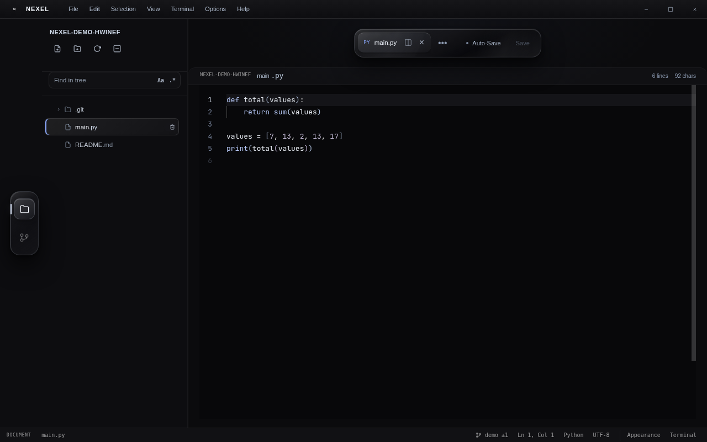
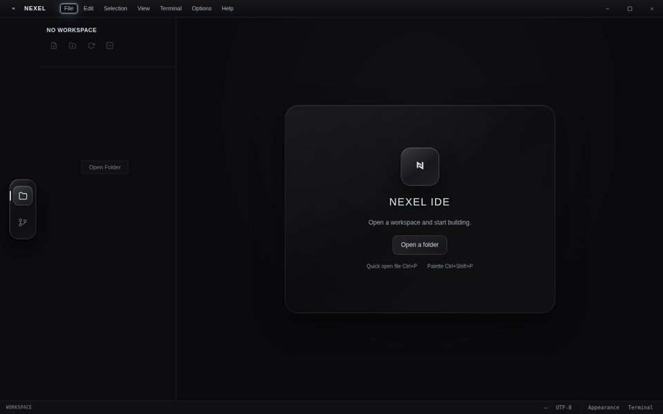
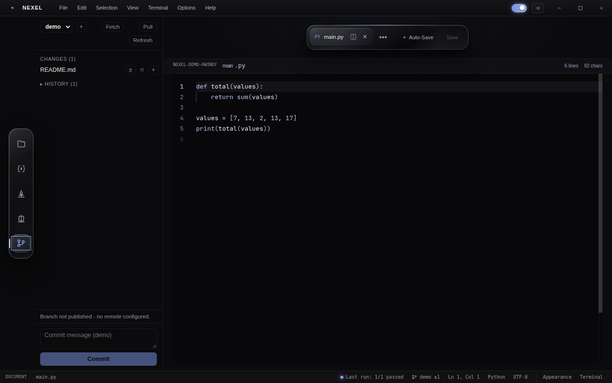
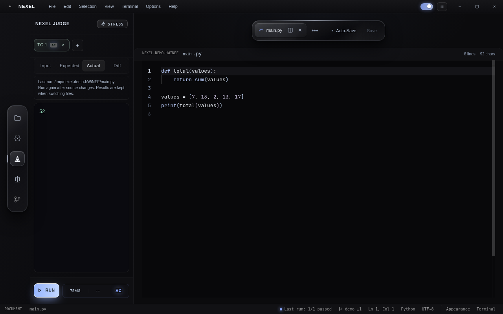

# Nexel IDE 2

A desktop code editor with a quiet glass workspace, a floating file rail, and tools you turn on when you need them.



## See it work



Recorded from the running Electron app on Linux: open a workspace, edit code, enable optional tools, run a Python testcase, and inspect local Git changes. This is the real interface, not a mockup. The recording is a short sequence of screen captures.

## Branch status

This is the `original-glass-integration` development branch. `main` is unchanged.

The newest source is preserved in **`1-nexel-ide-2-source-20261105-1432.tgz`**. Normal source-tree publication is still in progress. Until that finishes, use the snapshot instructions below rather than assuming the existing `nexel-ide/` folder contains every change shown here.

## A workspace first

- Monaco editing with tabs, split panes, file navigation, find/replace, command palette and keyboard controls.
- A glass dock and floating file rail that keep the editor at the center.
- Integrated terminal with native PTY support and a pipe fallback when native bindings are unavailable.
- File conflict warnings and guarded saves that protect unsaved edits when disk contents change.
- Local Git status, diff review, staging, commits, branches and history. Fetch, pull and push are explicit actions, not background operations.



## Add only the tools you need

Settings contains an Extensions picker. Competitive Programming, Data Tools, Document Navigator, Text Compare, Document Insights, Regex Lab, Time Lab and Color Lab can be enabled individually. Optional tools are off by default; Git is available in the normal workspace.

Data Tools includes JSON formatting, UTF-8 Base64 and URL conversion, line transformations and text hashes. The document tools work with the current editor context. They are not a marketplace for arbitrary third-party extensions.

## Competitive programming, when you want it

Enable **Competitive Programming** in Settings for Judge, stress testing, Codeforces views and Competitive Companion imports.



- C++ compilation and Python execution verified against real local toolchains.
- Input, Expected, Actual and Diff readers with per-case verdicts.
- Save-and-run for dirty source, cancellation, bounded output and runtime diagnostics kept separate from stdout.
- Exact UTF-8 output across streamed chunks, including Hindi and the globe shown in the validation runs.
- Historical results stay available with their run source named; changing files does not silently claim a new run.
- Stress testing compares a solution with a brute-force program and can add a failing example to Judge.
- Companion imports create files without overwriting existing ones and keep their original destination if you switch workspaces.

Java remains a supported code path but was not verified successfully in the current Linux environment because `javac` could not run. Do not read that as a tested Java setup.

The earlier `1-nexel-ide-2-source-20261105.tgz` is incomplete and superseded. Do not use it. The corrected archive includes language-tooling sources and test setup that the first selection omitted.

## Run the latest snapshot

Use a new folder so you do not overwrite an existing checkout or your own edits:

```sh
git clone --branch original-glass-integration --single-branch https://github.com/naman-sharma12345/nexel-ide.git nexel-ide-2
cd nexel-ide-2
mkdir snapshot
tar -xzf 1-nexel-ide-2-source-20261105-1432.tgz -C snapshot
cd snapshot/nexel-ide
npm install
npm run typecheck
npm run build
npm run electron:dev
```

Use Node.js 22 or newer with npm. The app needs a desktop environment. Native terminal bindings may need your OS build tools. To run Judge, install the relevant compiler/runtime on PATH: `g++` for C++, `python3` on Unix or `python` on Windows, and a JDK for Java.

For C/C++ language-server features in development:

```sh
npm run fetch:clangd
```

When clangd is unavailable the app uses built-in language helpers. Full semantic tooling depends on a working language server and compiler/header setup.

### Useful commands

Run these inside the application folder:

| Command | Purpose |
| --- | --- |
| `npm run dev` | Vite renderer development server |
| `npm run electron:dev` | Vite and Electron together |
| `npm run typecheck` | TypeScript project build check (`tsc -b`) |
| `npm run build` | Typecheck and production renderer build |
| `npm test -- --maxWorkers=1 --no-file-parallelism` | Unit and integration tests |
| `npm run test:e2e` | Playwright workflow tests |
| `npm run dist:linux` | Build and package for Linux |
| `npm run dist:win` | Build and package for Windows |
| `npm run dist:mac` | Build and package for macOS |

Packaging scripts exist; this branch does not claim newly verified installers for every OS.

## Validation and limits

Latest local validation on November 5, 2026:

- Canonical typecheck and production build passed.
- 1,146 unique unit/integration tests passed across 170 files. Four opt-in native tests were skipped in that sweep and passed separately against the real Linux runner.
- Actual Electron workflows checked editor saves, Git in disposable repositories, plugin lifecycle, Companion imports, UTF-8 output, runtime errors and narrow layouts.

These are Linux results, not cross-platform certification. Network Git login/SSH prompts and Windows/macOS behavior need their own testing. Codeforces availability depends on the service. Saved Judge results describe a past run, not current disk contents or an atomic build snapshot. External files can change between checks. Narrow layouts use scrolling where content cannot fit.

The Judge uses Bubblewrap when available on Linux and resource-limited process execution otherwise. The fallback is not a strong isolation boundary for hostile code. Run only code you trust on your own machine.

## Project layout

```text
nexel-ide/
  main.cjs                 Electron entry and IPC handlers
  preload.cjs              Renderer bridge
  src/components/          Editor and shared UI
  src/plugins/             Optional tool panels and Git
  src/stores/              Workspace and editor state
  src/lib/                 Editor and workflow helpers
  src/main/services/       Filesystem, Git, Judge and language services
  src/judge-backend/        Local execution and resource limits
  public/fonts/            Offline font assets and licenses
  scripts/                 Toolchain download helpers
  tests/e2e/               Playwright workflows
```

Nexel IDE 2 keeps the original Nexel identity while making the everyday editor, tools and failure paths easier to use.
